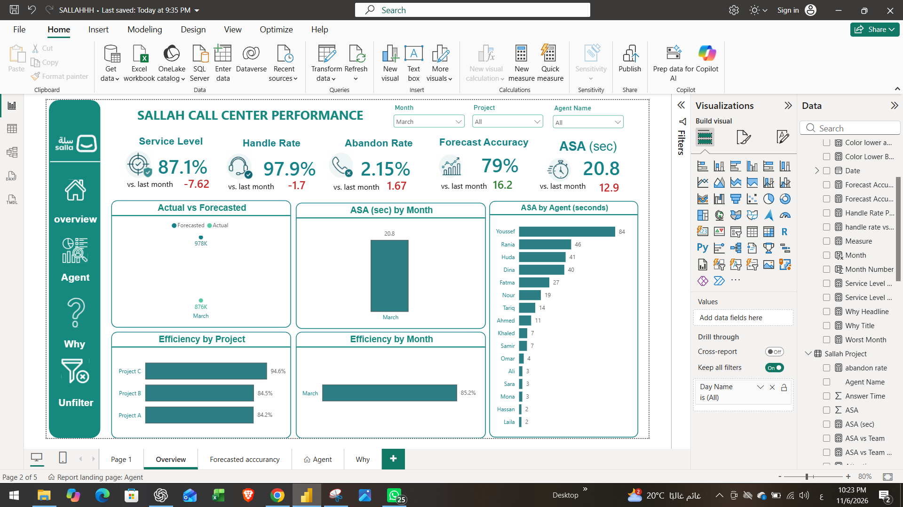
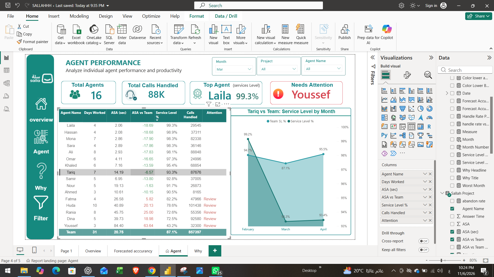
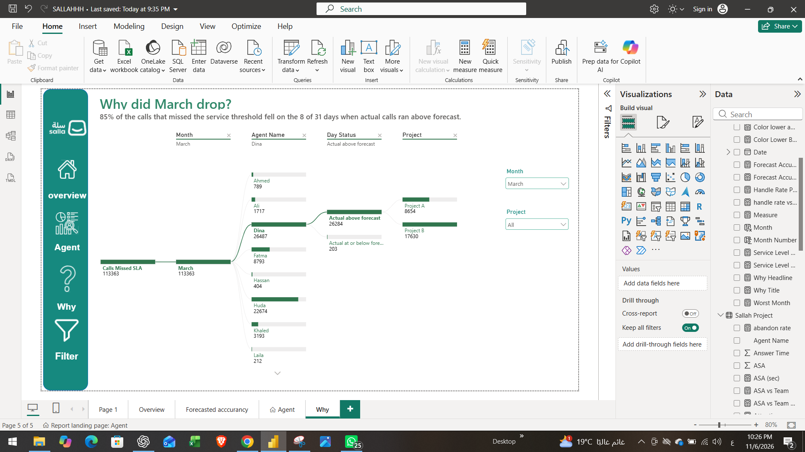

# Call Center Performance Dashboard (Power BI)

A 4-page Power BI report on 1.74M call-center calls (Feb to Apr), built to answer one question: **why did service drop in March?**

## Key findings
- March Service Level fell to **87.1%** (94.7% in February, 95.5% in April).
- **85%** of the calls that missed the service threshold fell on **8 of 31 days** when actual calls ran above forecast.
- The monthly forecast looked fine (10% above actual in March), but the daily view showed the days that broke service.
- Simple-average ASA gave 14.4 s for March; the weighted ASA is **20.8 s**.

## Pages
| Overview | Agent |
|---|---|
|  |  |

| Agent | Why |
|---|---|
|   |  |

## Key measures (DAX)
- Service Level % = calls answered within threshold / calls offered
- ASA (sec) = total answer time / calls handled (weighted, not a simple average)
- Forecast Accuracy = 1 - sum(|actual - forecast|) / sum(forecast), per row
- Month-over-month change in percentage points via DATEADD

## Notes
- Sample data. Agent names are fictional.
- Built with Power BI Desktop. Open the `.pbix` file in `data/`.
