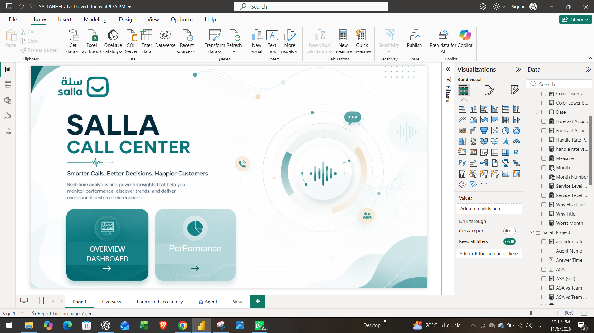
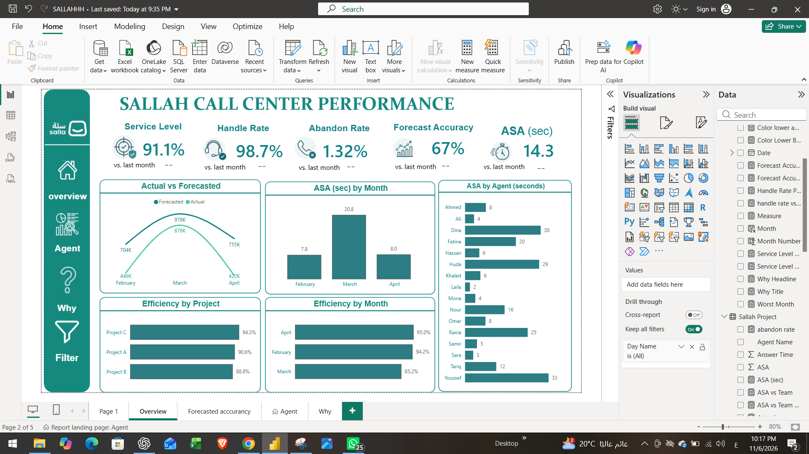

# Call Center Performance Dashboard (Power BI)

A Power BI report on 1.74M call-center calls (Feb to Apr), built to answer one question: **why did service drop in March?**

## Key findings
- March Service Level fell to **87.1%** (94.7% in February, 95.5% in April).
- In March, **85%** of the calls that missed the service threshold fell on **8 of 31 days** when actual calls ran above forecast.
- The monthly forecast looked fine (10% above actual in March), but the daily view showed the days that broke service.
- A simple-average ASA gave 14.4 s for March; the weighted ASA is **20.8 s**.

## Pages
| Home | 
|---|---|
|  | 
|Overview |
|---|---|
 |  

| Agent | Why |
|---|---|
|  |  |

## Key measures (DAX)
```dax
Service Level % = DIVIDE([Calls In Threshold], [Calls Offered])

ASA (sec) = DIVIDE([Total Answer Time], [Calls Handled])

Day Status =
VAR dt = 'Sallah Project'[Date]
VAR o = CALCULATE(SUM('Sallah Project'[Calls Offered]), ALL('Sallah Project'), 'Sallah Project'[Date] = dt)
VAR f = CALCULATE(SUM('Sallah Project'[Forecasted Calls]), ALL('Sallah Project'), 'Sallah Project'[Date] = dt)
RETURN IF(o > f, "Actual above forecast", "Actual at or below forecast")
```
- ASA is weighted (total answer time / calls handled), not a simple average.
- Month-over-month change is shown in percentage points using DATEADD.

## Limitations
- No staffing data, so staffing as a cause is a hypothesis to confirm with shift plans.
- Day-level detail is from March only. Correlation is not proof of cause.
- Agent results depend on project and daily load, so compare agents within the same project.

## Notes
- Sample data. Agent names are fictional.
- Built with Power BI Desktop.
